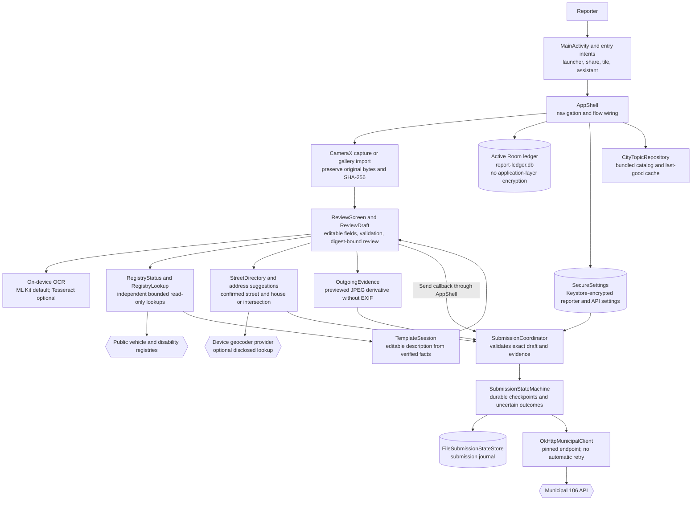
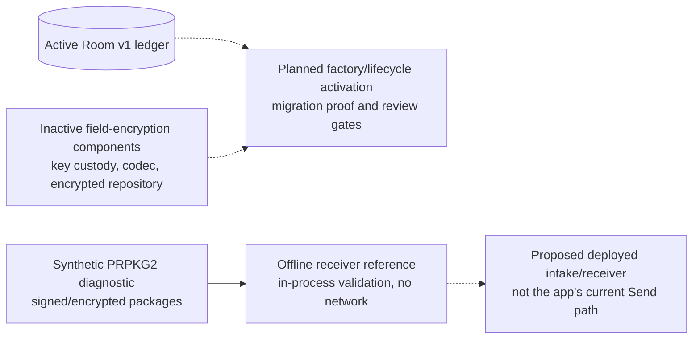
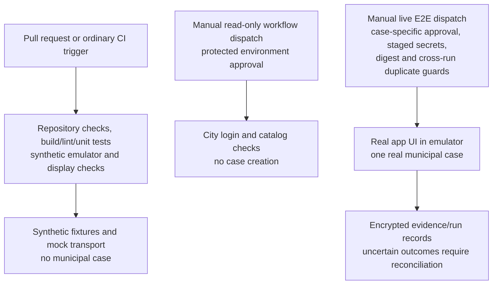

# Architecture

Development preview, not a production-readiness claim. This is the current Android runtime map, checked against source on 2026-11-16. Implementation status must be rechecked when code changes. The [design notes](docs/DESIGN.md), [preview status](M1_STATUS.md) and [live-test gates](docs/LIVE_E2E.md) add detail.

Solid arrows below describe active paths. Dashed arrows describe inactive or proposed work, not hidden runtime transport. No diagram authorizes a live municipal case.

## Active Android runtime

The drawing groups responsibilities, not every function call. `AppShell` owns capture/review navigation, Room reads/writes and the callback that constructs `SubmissionCoordinator`. `ReviewDraft` is a data model, not a persistence service. Street-directory resolution is local; only the separate optional geocoder suggestion path contacts its provider.

- **Evidence and review:** originals stay separate from the previewed outgoing derivative. Corrections do not overwrite original metadata. Sending requires valid fields and a matching original hash and outgoing preview. Editing invalidates the reviewed content digest.
- **Storage:** `AppShell` opens `ReportDatabase` directly. Report content in this active Room ledger is not application-layer encrypted. Android sandbox/device encryption still apply. `SecureSettings` encryption does not encrypt the ledger. Original photos and submission-state files are separate stores; do not infer whole-app encryption from settings encryption.
- **Submission:** Send routes through the app's device-credential flow and current validation, then the coordinator and state machine. Municipal credentials are entered into encrypted settings, never bundled. The endpoint is public configuration, not authorization. Case creation and photo attachment are separate steps; a partial or uncertain write is not a safe automatic retry.
- **Registry and templates:** lookups do not gate Save/Send. Verified live results may supply editable description sentences through `TemplateSession`; failed, partial or cached results must not be turned into fresh negative findings. The private fallback cache is described in [registry cache](docs/REGISTRY_FALLBACK_CACHE.md).
- **Categories:** the city catalog and plate requirements are separate from suggestions. The current generic `StubCategorySuggester` is not a trained classifier. The separately documented experimental sidewalk model is optional and locally loaded.

### Source map

| Responsibility | Source |
| --- | --- |
| Entry and navigation | `MainActivity.kt`, `EntryIntents.kt`, `ReportTileService.kt`, `ui/AppShell.kt`, `assistant/` |
| Capture, import, metadata and outgoing preview | `capture/`, `evidence/GalleryImport.kt`, `evidence/EvidenceReader.kt`, `evidence/OutgoingEvidence.kt` |
| Review, template facts and category hints | `ui/ReviewScreen.kt`, `core/ReviewDraft.kt`, `core/TemplateSession.kt`, `core/CategorySuggester.kt` |
| Active local ledger and settings | `ledger/ReportDatabase.kt`, `security/SecureSettings.kt` |
| Topic/address services | `municipal/CityTopicRepository.kt`, `municipal/StreetDirectory.kt` |
| Public lookups | `ui/RegistryStatus.kt`, `registry/` |
| Submission and recovery state | `municipal/SubmissionCoordinator.kt`, `municipal/SubmissionStateMachine.kt`, `municipal/FileSubmissionStateStore.kt`, `municipal/MunicipalClient.kt` |

Paths in this table are relative to `app/src/main/java/io/github/reihlinstinct/reporter/`.

## Inactive and proposed paths

`EncryptedLedgerRepository` is explicitly inactive: production database activation and factory/lifecycle wiring are absent. It must not be drawn between today's UI and `ReportDatabase`. See [encryption design](docs/LEDGER_ENCRYPTION.md), [repository stage](docs/LEDGER_REPOSITORY_STAGE.md) and [rollout gates](docs/LEDGER_ENCRYPTION_ROLLOUT.md). The old [migration diagram](docs/LEDGER_MIGRATION_PHASES.md) is marked superseded and retained for history, not implementation guidance.

PRPKG2 packaging and the [offline receiver](docs/OFFLINE_RECEIVER.md) are separate synthetic/reference capabilities, not a deployed relay in front of the direct municipal client. The [intake protocol](docs/ENCRYPTED_INTAKE_PROTOCOL.md) remains a proposal. Nothing in this map activates either proposed path.

## CI and external effects

Ordinary CI does not stage a live case. The manual `city-readonly-checks.yml` and `live-emulator-e2e.yml` have different effects and gates; they are not interchangeable. See [live E2E](docs/LIVE_E2E.md) for the current opt-in chain and retention limits. This diagram does not dispatch either workflow, claim a recent passing run, or establish physical-device validation.

## Platform roadmap

Android first, then port the design and screens to iOS. There is no simultaneous shared-UI implementation implied here. Keep feature names, locale strings and entry contracts portable while separating report-flow logic from Compose UI.
