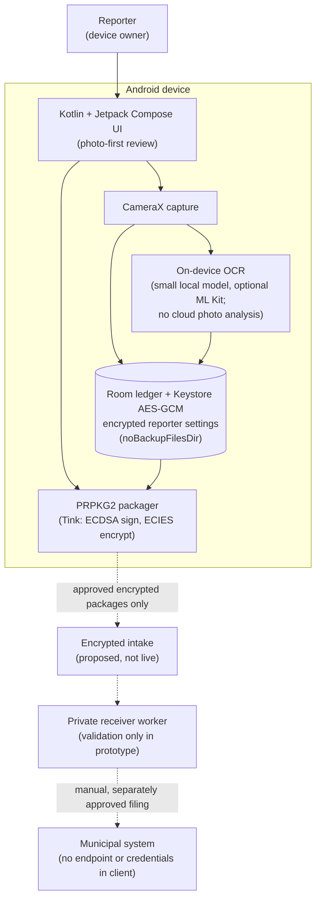
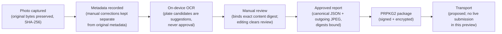

# Architecture

Development preview. This document gives the high-level system context and data flow. Details and release gates live in [docs/DESIGN.md](docs/DESIGN.md); the encrypted intake proposal lives in [docs/ENCRYPTED_INTAKE_PROTOCOL.md](docs/ENCRYPTED_INTAKE_PROTOCOL.md). Diagrams use synthetic entities only: no real plates, locations or living-person data.

## System context

## Data flow (report lifecycle)

## Security boundary

- The public client holds no municipal endpoint, credential or secret, and no private repository identifier.
- Reporter settings (first name, last name, phone, ID, email) stay encrypted on-device with Keystore AES-GCM; no plaintext fallback or backup.
- Approval is local and binds an exact content digest; it is not a submission receipt.
- Anything leaving the device is an encrypted package to a pinned receiver public key; the private decryption key never lives in the app.
- Transport, enrollment and municipal filing are proposed stages (M5) and remain outside this preview.
