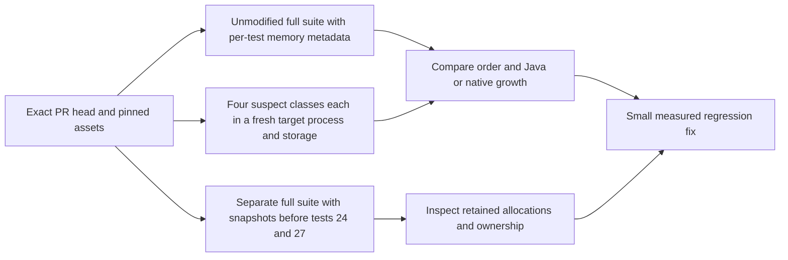

# API29 retained-heap diagnosis (#684)

Status: diagnostic only, no memory fix and no guilty commit identified.

The exact green #669 head and the failing main merge have identical source trees. The first recorded failure moved between EntryPointsTest and FirstRunScreenTest; later failures include review recreation and unsaved-back tests. The observed application growth limit is 16 MiB. An allocation stack shows where memory ran out, not what retained the heap.

## Experiment

The `API29 retained heap diagnostic` workflow has five independent modes:

- `suite`: full suite, no forced GC or heap dumps. The listener logs Java used/committed/max bytes and native allocated bytes before and after each test.
- `fresh-suite`: the full suite after the same force-stop and private-storage reset used by isolated mode. No heap or system-property setting changes. This distinguishes reset effects from test-history effects.
- `snapshots`: the same suite plus HPROF snapshots before ordinal 24 and 27. These are investigation checkpoints around prior failures, not stable test identities. The trace records the exact class and method at each ordinal. Dumping can force GC and change timing, so this mode must not substitute for the no-snapshot baseline.
- `isolated`: EntryPointsTest, FirstRunScreenTest, ReviewRecreationTest and ReviewUnsavedBackTest, each in a fresh target process and private storage. Passing here does not prove the full suite passes. This diagnoses dependence on suite history; it does not reduce normal coverage.

No retry, heap increase, application change, municipal endpoint, reporter credentials or private photo is added. Normal API29/30/36 and display checks remain unchanged. The optional listener exists only in the test APK and is inactive unless explicitly selected. There is no device-user workflow or automatic profiler in the production app.

All artifacts come from fresh synthetic CI devices. Never run this public-artifact workflow on real user data or an authenticated production device. Snapshots may contain every synthetic in-memory test field. Artifacts expire after seven days.

## Evidence and next decision

Read the unmodified-suite trace first. Correlate heap growth with test boundaries and lifecycle transitions. Compare isolated classes to the suite history. Inspect snapshot dominators and GC roots, including address points, Compose owners and callbacks, databases and native OCR resources. None is assumed guilty before that evidence.

If the failure is reliably tied to a source change after test-history isolation, compare adjacent commits with the same tests, asset pin and emulator settings. Do not call a rollback a successful commit bisect. Do not close #684 with this diagnostic PR.

The online-address/cache request is a separate feature. It may reduce retained address data but is not evidence that address data caused this failure.

## First diagnostic evidence

At head `2f169127`, the suite reproduced OOM at test 28. The four isolated classes passed, but the listener measured a 512 MiB Java maximum in isolated mode versus 16 MiB in suite mode, despite both devices reporting `dalvik.vm.heapsize=512m` and an empty `heapgrowthlimit` property. Therefore isolated PASS is not a matched-budget comparison and does not establish a suite-history leak. A fresh-full-suite control and complete emulator properties/package metadata have been added to investigate that difference without modifying the heap. The snapshot job failed resolving the pinned KSP plugin before tests, so it supplied no snapshot evidence. No culprit identified.

## Second diagnostic evidence and measurement corrections

At `31c2bff`, full-suite, fresh-suite and snapshots all passed with a measured512MiB cap. The isolated classes passed17tests with a16MiB cap. Sampled Java peaks in the three full-suite modes were about87–140MiB. Device properties still report heapsize512m with empty growthlimit. These runs remain unmatched, not proof of a leak or its absence.

The snapshot artifact extraction incorrectly requested28/111 although the listener wrote24/27. Worse, `adb exec-out run-as ... cat` returned zero and the redirected nonempty error text passed the old file-size guard. Those artifacts are not HPROF evidence. Extraction now matches24/27 and requires the HPROF binary signature; synthetic tests cover nonempty error text.

A `paired` mode now runs the full suite followed by the four isolated classes on the same emulator, with no heap change and no test retries. Every process records actual Runtime.maxMemory, PID, process bitness, supported ABIs, ActivityManager memory classes and low-RAM status. Same device alone does not prove the budgets match; compare these values before interpreting results. The varying16/512MiB process cap is an unresolved environment lead.

## Boot-race hypothesis, not yet confirmed locally

Android10 emulator zygote can start before its heap-size property is initialized, inheriting the AndroidRuntime16m fallback. Later `getprop` can show512m while target processes still inherit16m. This exactly fits the observed mismatch, but the old logs were cleared before tests and cannot prove startup ordering.

Sources inspected:
- https://www.rainforestqa.com/blog/hunting-race-condition-in-android-10-emulator
- https://github.com/ReactiveCircus/android-emulator-runner/issues/264
- https://android.googlesource.com/platform/frameworks/base/+/369320574a87c15adc743a459944cecbff4b33fe/core/jni/AndroidRuntime.cpp

A separate `boot-probe` diagnostic records initial boot logs and actual init files, then samples up to8cold boots using one tiny instrumentation test without UI/address loading. If Runtime.maxMemory is16MiB while the configured property is512m, it records before/after a warm zygote restart on that synthetic device only. This is a control intervention, not a production CI fix. No heap property, application manifest, dependency or minimum SDK changes. No test failure is retried; each boot's observation is retained. A cold run without the mismatch is explicitly not-reproduced, never proof that the race is absent. A restart that does not restore512MiB is not claimed to do so.

At422025e all five diagnostic modes and normalCI passed. Paired full suite sampled about106MiB Java used before GC, compared to about38MiB peak in the isolated classes, all with the same512MiB actual cap. Different test histories and GC headroom still prevent calling that difference a retained leak. Valid HPROFs are now available; early histogram inspection is not a retained-owner verdict.
