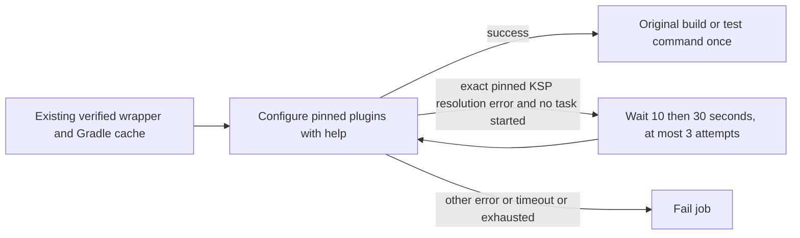

# Bounded plugin-resolution preflight

The regular Android and display jobs already use the pinned setup-java action's Gradle cache. A cache miss or remote plugin repository outage can still stop configuration before the app compiles, as seen on main run 44464788416 for pinned KSP 2.3.14.

`python3 scripts/warm_gradle_plugins.py` runs `gradlew --no-daemon help` before the build or emulator starts. It keeps all existing pinned versions, repositories, verification files and cache policy.

Only the exact unresolved KSP plugin declaration and artifact for the version in build.gradle.kts qualify. Any started task, different version/plugin, generic error or timeout fails without retry. This is a configuration preflight, not a retry wrapper for a compile, unit test or instrumented test. A later resolution failure in the original build still fails normally.

There are at most three configuration attempts, each bounded to180seconds, and40seconds of total backoff. Success takes one configuration pass, often served by the existing Gradle cache. This may reduce transient failures; it cannot guarantee an unavailable repository recovers. No private or paid runner, dependency mirror, new action or extra emulator is used. Standard Ubuntu jobs stay within their existing timeouts.

Synthetic tests inject subprocess results and cover exact resolution then recovery, exhaustion, unrelated/compiler/test failures, wrong pins and timeouts. They never resolve real dependencies.

## First CI feedback

At6ad7fff, both display jobs exhausted three attempts with the same KSP resolution error before any tasks. The plain repeated `help` invocation did not recover those jobs; this is not a confirmed fix yet. The pinned marker and plugin POM are available from Plugin Portal and Maven Central when checked independently, which does not prove availability from a particular runner.

Gradle [documents negative artifact caching and dependency refresh](https://docs.gradle.org/current/userguide/dependency%5Fcaching.html). Retries two and three now pass `--refresh-dependencies` to the configuration-only `help` invocation. The first attempt and the original builds/tests are unchanged. Downloaded artifacts and verification remain intact; Gradle can reuse matching artifacts after checking metadata/checksums. No directory is deleted, no dependency pin or repository changes. Negative caching is a plausible mechanism, not yet a demonstrated root cause of the runner failures. Retry count, timeout and error classification remain unchanged.
