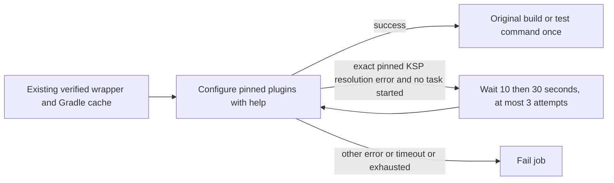

# Bounded plugin-resolution preflight

The regular Android and display jobs already use the pinned setup-java action's Gradle cache. A cache miss or remote plugin repository outage can still stop configuration before the app compiles, as seen on main run 44464788416 for pinned KSP 2.3.14.

`python3 scripts/warm_gradle_plugins.py` runs `gradlew --no-daemon help` before the build or emulator starts. It keeps all existing pinned versions, repositories, verification files and cache policy.

Only the exact unresolved KSP plugin declaration and artifact for the version in build.gradle.kts qualify. Any started task, different version/plugin, generic error or timeout fails without retry. This is a configuration preflight, not a retry wrapper for a compile, unit test or instrumented test. A later resolution failure in the original build still fails normally.

There are at most three configuration attempts, each bounded to180seconds, and40seconds of total backoff. Success takes one configuration pass, often served by the existing Gradle cache. This may reduce transient failures; it cannot guarantee an unavailable repository recovers. No private or paid runner, dependency mirror, new action or extra emulator is used. Standard Ubuntu jobs stay within their existing timeouts.

Synthetic tests inject subprocess results and cover exact resolution then recovery, exhaustion, unrelated/compiler/test failures, wrong pins and timeouts. They never resolve real dependencies.

## First CI feedback

At6ad7fff, both display jobs exhausted three attempts with the same KSP resolution error before any tasks. The plain repeated `help` invocation did not recover those jobs; this is not a confirmed fix yet. The pinned marker and plugin POM are available from Plugin Portal and Maven Central when checked independently, which does not prove availability from a particular runner.

Gradle [documents negative artifact caching and dependency refresh](https://docs.gradle.org/current/userguide/dependency%5Fcaching.html). Retries two and three now pass `--refresh-dependencies` to the configuration-only `help` invocation. The first attempt and the original builds/tests are unchanged. Downloaded artifacts and verification remain intact; Gradle can reuse matching artifacts after checking metadata/checksums. No directory is deleted, no dependency pin or repository changes. Negative caching is a plausible mechanism, not yet a demonstrated root cause of the runner failures. Retry count, timeout and error classification remain unchanged.

## Direct KSP repository routing

KSP's pinned marker and implementation POMs are on official Maven Central. The Plugin Portal redirects the marker there; Google Maven returns 404 for this marker. Both pluginManagement and dependencyResolutionManagement now use exclusive content for exactly `com.google.devtools.ksp` at Maven Central. Other Google, Portal, Central and restricted JitPack groups keep their existing routes. No version change, new mirror, vendored JAR or weaker verification is introduced.

Existing setup-java caching already restores Gradle caches. More overlapping caches or a larger retry budget would cost minutes and would not prove the cause. Gradle caches repository-specific metadata, including absent artifacts; the existing later attempts keep `--refresh-dependencies`. The preflight remains three help-only attempts with 10/30 second waits, before compilation/tests. No tests retry.

After the third exact KSP-only failure, four five-second HEAD requests (two artifacts against each of two official Central hosts) report only numeric status or a fixed network-unavailable label for the pinned marker and implementation on Central. They never read response bodies, print arbitrary error text or follow redirects. These probes never turn failure into success. Central 200 with Gradle resolution failing points toward Gradle metadata/routing rather than proving a Central outage; a failing HEAD is only evidence from that runner at that moment.

The historic CI logs expose the unresolved marker but not the underlying HTTP cause. Negative caching or a transient repository edge is a hypothesis, not an established root cause. Direct routing is a measured reduction in failure surfaces; new green CI demonstrates compatibility, not proof that all future outages are fixed.

Sources:
- https://docs.gradle.org/current/userguide/filtering_repository_content.html
- https://docs.gradle.org/current/userguide/dependency_caching.html
- https://github.com/actions/setup-java
- https://github.com/google/ksp/issues/2021
- https://repo.maven.apache.org/maven2/com/google/devtools/ksp/com.google.devtools.ksp.gradle.plugin/2.3.14/com.google.devtools.ksp.gradle.plugin-2.3.14.pom
- https://repo.maven.apache.org/maven2/com/google/devtools/ksp/symbol-processing-gradle-plugin/2.3.14/symbol-processing-gradle-plugin-2.3.14.pom

The captured Kotlin JVM marker POM fixtures live under
`app/src/test/resources/gradle/kotlin-jvm-marker-2.4.21/` because they are
read-only evidence consumed by the project's repository checks alongside its
other test resources. They are not a Maven repository, a dependency cache or
root dependency-verification metadata. The root Android build currently pins
versions and official HTTPS origins, not artifact hashes. The separate
`api-bridge/gradle/verification-metadata.xml` protects only that standalone build.
