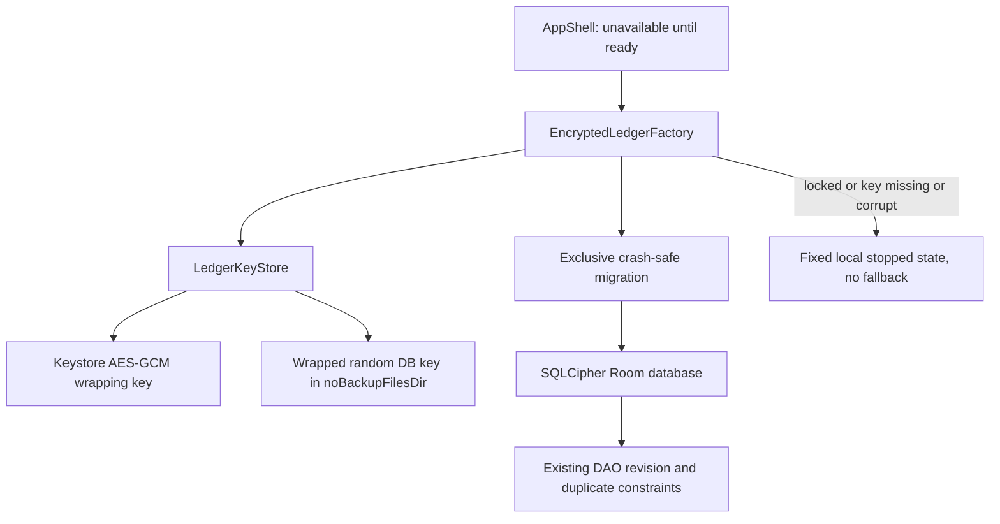

# Encrypted report ledger (#88)

Status: proposed security design. No encryption is installed by this PR. Current
Room v1 stores private draft JSON in plaintext at the application layer. Device
sandbox and device encryption still protect it; no public exposure is asserted.

## Decision and boundaries

Encrypt the whole Room database with SQLCipher, not only draftJson. Original
paths, hashes, approval digests and stable identifiers are also sensitive. Keep
DraftCodec a serialization-only component. No API, filing, network, settings or
external-distribution change. Original image encryption is a separate inventory
item; this database change must not claim to protect image files.

Use the maintained sqlcipher-android API with SupportOpenHelperFactory, not the
retired android-database-sqlcipher package. Pin a verified compatible release in
the implementation PR and prove Room/16-KB native-page compatibility. This design
does not approve a dependency merely because it is the latest. No hash-locked
pip install or paid service is involved.

## Placement and dependency direction

Add ledger/EncryptedLedgerFactory and security/LedgerKeyStore, with a small
injected migration filesystem/key boundary for tests. AppShell depends on a
ready/locked/unavailable ledger state, never directly constructs plaintext Room.
Keep ReportDao revision-CAS, duplicate-photo constraints and digest semantics.
Update existing ledger tests and add dedicated unit/instrumentation tests under
matching test packages. No new root code.

## Keys and locked-device lifecycle

Generate a random 256-bit database key once; wrap it with an independent
non-exportable Android Keystore AES-GCM key, random nonce and versioned AAD.
Wrapped material belongs in an AtomicFile in noBackupFilesDir, never preferences,
logs, saved UI state or arguments. Separate alias from reporter settings.
Only generate on proven first initialization with no existing key/database or
migration marker. Existing database plus missing/invalid key stops. Never delete
or regenerate to make an open succeed. No destructive Room fallback.

Use secure-device authentication for unwrap with a short validity window, using
the existing credential prompt pattern. Missing secure lock stops with setup
instructions. Authentication expiry, biometric enrollment/key invalidation and
lock-screen removal do not erase data automatically. Clear mutable key buffers
when possible and close database handles when backgrounded/locked. A closed key
store alone does not revoke an already-open SQLCipher connection, so lifecycle
closure and subsequent reauthentication are acceptance requirements. Do not rely
only on setUnlockedDeviceRequired on API 34 and below due to documented platform
bugs. Recovery means explicit user-visible local reset/export policy later,
never hidden plaintext fallback or automatic data destruction.

## Migration v1: separate file, explicit journal

Run before exposing any DAO/UI write. Serialize initialization within process
and acquire an OS file lock for migration. Distinguish legacy plaintext by the
known header plus successful v1 schema validation; wrong-key encrypted databases
must not be reclassified as plaintext after a failed open.

1. Authenticate and durably save the wrapped new key and a value-free migration
   marker. Refuse ambiguous combinations or unexpected schema versions.
2. With legacy database exclusively quiescent, checkpoint its WAL and close all
   ordinary Room/SQLite handles. Treat database, WAL and SHM as one source set.
3. Export to a separate encrypted temporary database using sqlcipher_export;
   copy user_version explicitly because the export does not transfer it.
4. Validate schema/Room identity, row counts and all row values through a private
   in-memory comparison. Exercise constraints and SQLCipher integrity checks.
   Never log those values, hashes or database keys.
5. Fsync the encrypted destination and directory; atomically select it as the
   canonical encrypted file with a durable phase marker. Reopen with the wrapped
   key and verify it before deleting the legacy database and sidecars.
6. Remove legacy source/sidecars and migration temporary files, fsync directory,
   then mark complete. No ledger access while cleanup is incomplete.

Crash phases must be recoverable without selecting an unverified copy or writing
to both. Before verification retain the legacy source and resume/rebuild only
the encrypted temporary copy. After canonical selection, verify encrypted copy
and finish cleanup, never reopen plaintext for normal operation. Fail on disk
full, sync/rename failure or malformed marker. Logical deletion cannot guarantee
forensic erasure on flash; document that limit, do not promise secure overwrite.

## Backup and transfer

Existing allowBackup=false, legacy backup_rules and modern data_extraction_rules
already exclude databases and private files for cloud and device transfer.
Preserve and regression-test all three, including both extraction sections.
No new backup channel or recoverable key export. Restored database without key
must fail closed. Data loss after uninstall/key loss is an explicit limitation.

## Acceptance before implementation merge

- Synthetic real-v1 database migration preserves every record/revision/digest,
  uniqueness and DAO CAS behavior; reopen and interrupted-phase tests on device.
- Scan database/WAL/SHM/temp bytes for synthetic distinctive plaintext after
  successful cleanup; ordinary SQLite cannot read the encrypted database.
- Wrong key, ciphertext/header tampering, missing wrapper, corrupt journal,
  authentication expiry, lock/background and invalidated key stop without reset.
- Failure injection at every sync/rename/delete phase, disk-full and concurrent
  initialization; no plaintext fallback, loss or duplicate approved operation.
- Backup/transfer rules tested; build/lint/unit and emulator tests actually run.
  Mutation tests remove encryption, no-fallback, verification-before-delete,
  backup exclusion and revision checks; all must be killed or explicitly blocked.
- Independent exact-head review and green CI, normal signed merge. A docs-only
  check passing is not evidence that migration/encryption already works.

## References

- https://www.zetetic.net/sqlcipher/sqlcipher-api/ (export and user_version)
- https://www.zetetic.net/sqlcipher/sqlcipher-for-android-migration/ (current API)
- https://developer.android.com/reference/android/security/keystore/KeyGenParameterSpec.Builder
