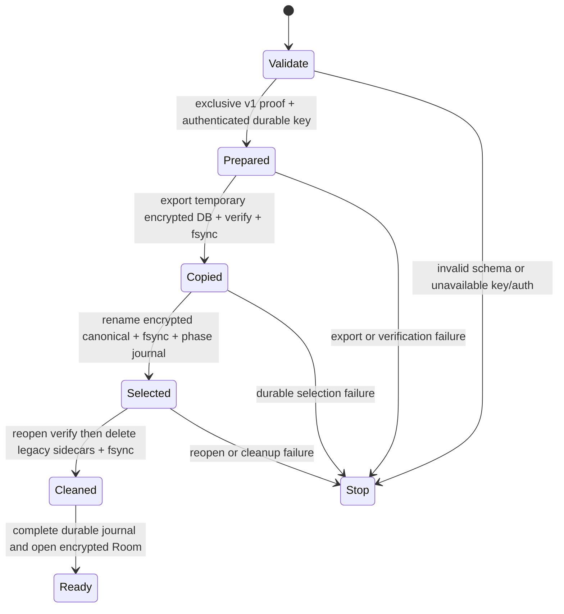

# Ledger migration phases and proof (#88, slice 2)

Status: design refinement before factory/UI wiring. All development tests use
synthetic databases. No real user data migration is authorized by this document.
Key custody PR90 is merged but unused; Room/UI still opens the plaintext ledger.

## Authority to initialize

The current loadOrCreateEmpty method never creates a data key when database or
migration history exists. Keep it that way. Legacy migration needs a separate
internal proof type issued only after exclusive validation of a specific Room v1
schema, user_version, database identity and complete row inventory. No public
boolean, exception fallback or failed encrypted open is such a proof.

Proof binds the canonical source path/stat identity and verified schema/version,
not private values in a public log. It is valid only under the same process/OS
migration lock and invalid after any source change. Authentication is required
independently; proof of schema never substitutes for authentication.

## Files and phases

Canonical encrypted path is report-ledger-encrypted.db, distinct from the old
report-ledger.db. Journal and wrapped key live under noBackupFilesDir; use a
strict versioned journal with fixed phase and no plaintext record values.
Never put a raw database key in a SQL string, process argument, log or journal.
Use supported bind/key APIs; verify exact SQLCipher/Room API before code.

Every arrow is an independently fault-injected boundary, not an in-memory flag.
A phase written before its required durability receipt is invalid. Marker writes
use explicit sync/rename/directory sync plus authenticated readback as with key
custody, not AtomicFile's logged-error success behavior.

## Restart table

| Last durable state | Required safe action | Never do |
|---|---|---|
| No journal, legacy only | validate v1 source under lock, authenticate, prepare | treat any database as a known v1 source |
| Prepared | verify key wrapper and source identity; rebuild unselected temp | replace key, write through legacy DAO or delete source |
| Copied | verify encrypted temp/canonical state, finish selection durably | select unverified temp or open plaintext as normal |
| Selected | reopen encrypted canonical with same key, verify and finish cleanup | re-export from stale legacy or permit writes before cleanup |
| Cleaned | verify encrypted canonical and mark ready durably | recreate deleted legacy or clear key on failure |
| Ready | authenticated encrypted open only | reclassify wrong key/corruption as plaintext |
| Missing/corrupt/contradictory files or marker | fixed stopped state, retain data | infer latest state by mtime, reset or destructive migration |

OS lock spans validation/export/selection/cleanup, and the factory remains the
sole opener. Existing Room handles must close before migration; lifecycle/UI
integration is a separate reviewed slice. WAL checkpoint and sidecars belong to
the source set. A partially removed legacy set after Selected can resume cleanup
only after revalidating encrypted destination. No plaintext fallback.

## Validation before source removal

SQLCipher export must preserve schema/triggers/indexes and explicitly copy
user_version and Room identity. Compare each row/column privately, not only counts.
Validate duplicate-photo uniqueness, primary key and revision CAS. Run integrity
checks and reopen encrypted destination with intended helper. Verify failure with
wrong key and ordinary SQLite. Distinctive synthetic values must not occur in
encrypted DB/WAL/SHM after successful cleanup. Flash deletion is not forensic erase.

## Test placement and scope

Pure decision model belongs in ledger/LedgerMigrationState.kt, with unit tests for
all phase/file combinations and every missing receipt. Android adapter/factory,
SQLCipher dependency and instrumentation follow separately. Pure model tests
cannot prove fsync, Room migration, key authentication, native16KB or lifecycle
correctness, and must never be reported as those receipts.

Before runtime wiring: real synthetic v1 migration on emulator, fault injection
at each write/sync/rename/reopen/delete, locked/expired/invalidated key, concurrent
factories and fresh-process restart. No mutation may make a missing verification,
durable receipt or cleanup gate permit Ready. Independent review/green CI per
slice; actual user migration still needs a separately relayed user approval.
