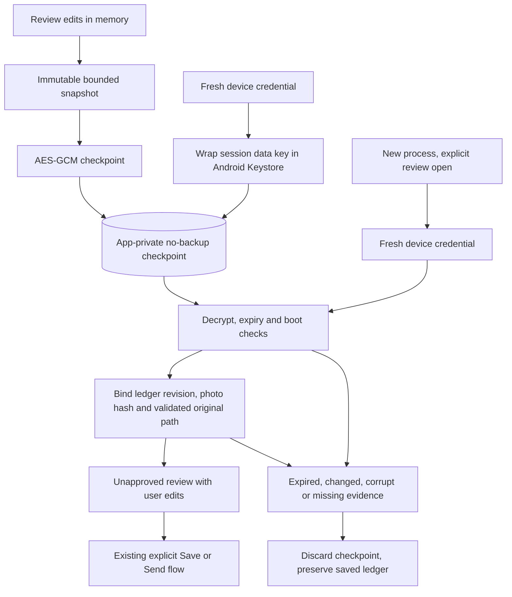

# Process-death review recovery (#358)

Status: proposed, inactive. Design review precedes implementation and activation. This document does not claim that unsaved edits currently survive process death.

## Baseline and decision

At main `c91fa30e738ec5206dd7c1d21f920d63cfd7be9f`, `AppShell` opens the existing Room ledger directly. That ledger is not application-layer encrypted. `ReviewRotationState` holds one screen and shell in process memory for at most 60 seconds, with independent timestamps. It restores rotation only. #536 tests real Activity recreation and revision continuity; #537 retains user plate edits and prevents automatic OCR from undoing a deliberate clear. Neither proves process death.

Add a separate encrypted, app-private, short-lived checkpoint of the active unsaved review. Do not activate the unfinished encrypted-ledger migration as a prerequisite, copy plaintext into Room, or store personal fields in saved-instance state. Restore only after a new device-credential authentication and fresh validation of the matching saved report. Recovery is never approval to send.

Chosen first-slice limits:

- One checkpoint total. No history, queue, account sync, export or backup.
- Absolute 15-minute lifetime from recovery-session creation, not from the last keystroke. Autosave and restore cannot extend it. A new explicit review opening after expiry can start a new session after authentication.
- Same boot only. Bind authenticated metadata to Android boot count plus monotonic creation/deadline values. Require an available, matching boot count and `created <= elapsedRealtime < deadline`; reject impossible negative age or unavailable boot identity. Wall time is diagnostic only and cannot extend retention.
- Devices without a secure lock retain today's memory-only behavior. Never create an authentication-free fallback key.
- Proposed interaction: fresh credential check on starting durable recovery and on recovery after process death. Cancel means ordinary memory-only review or return to saved draft, never data exposure or Send. No repeated auth popup per keystroke.
- New user-facing explanation/error text and accessibility announcements must be reviewed before activation. This design PR adds no app copy or controls.

## Data contract and exclusion boundary

Use a versioned `ReviewRecoverySnapshot`, not serialized Compose state or `Held` via reflection. Bound ciphertext to 256 KiB and decoded strings/lists to explicit per-field limits. Reject duplicate/unknown keys, non-finite coordinates, invalid enums, malformed UTF-8, unknown versions and trailing data. Define exact limits in the codec slice and test their boundaries before any caller is added. Do not truncate user text silently.

Persist only the state needed to reconstruct the active review:

- Stable report ID, original SHA-256, expected ledger revision and digest of the saved initial draft. Initial content is re-read from the ledger and must match, not trusted from disk metadata.
- Edited `ReviewDraft`, raw plate input (including incomplete input), plate edit provenance, raw coordinate text, raw manual street/house/cross-street, OCR prefill baseline, edit-panel state, user-text provenance and template ownership state.
- Saved manual-input baseline and any address warning baseline needed to distinguish automatic prefill from user edits. An omitted field must have an explicit safe default, not silently clear a warning.
- Confirmed manual address only as a typed candidate for validation. Do not revive in-flight location/geocoder/registry/OCR results or callbacks. Old suggestions may be dropped and explicitly requested again.

Do not persist credentials, settings/profile values, images, image bytes, absolute file paths, device authentication results, pending authentication callbacks, approval tokens, reviewedDigest authority, Send-ready grants, submission receipts, submission state, network handles, busy flags, pending jobs, or automatic retry intent. Keep the existing saved ledger and original file as their own sources of truth. A checkpoint does not delete or create originals or ledger rows.

An open discard dialog may be restored as UI only. It cannot encode a Save/Discard decision. Restoring a draft never marks it submitted, approved or currently authenticated. Existing validation and Send/device-auth paths run anew. If the durable submission state indicates started, partial, uncertain or submitted work for that report, do not apply a recovery checkpoint over that state: route through the existing reconciliation/receipt path with no automatic write.

### Live state mapping (durable candidates and exclusions at this baseline)

No generic object serialization. All persisted fields below live inside the encrypted snapshot and its authenticated binding. Raw text is never promoted to confirmed facts just by restoring it.

| Live Held/Shell field | Recovery action and validation/default |
| --- | --- |
| Held.initial | Do not persist content; bind its digest and re-read matching ledger baseline after auth. |
| Held.draft | Persist edited draft; validate schema, identity and field bounds; never infer approval. |
| Held.latitude, longitude | Persist raw strings; parse only through normal validation, nonfinite values rejected. |
| Held.manualStreet, manualHouse | Persist raw text, bounded; restore as unconfirmed edit inputs. |
| Held.savedManualStreet, savedManualHouse | Persist baseline strings to retain dirty detection; bind to session's saved baseline. |
| Held.ocrPrefilledPlate | Persist clean-baseline marker, validate format; it grants no confirmation. |
| Held.gpsFilled | Persist provenance only bound to matching coordinate text/draft fields. Missing/mismatch defaults false and retains location/address warnings; never start a location read. |
| Held.templateState | Persist bounded ownership/rendered identifiers; validate against current app version, never revive stale registry facts. |
| Held.textTyped | Persist boolean to protect user text from later automatic replacement. |
| Held.editing | Persist UI-only boolean, missing defaults false. |
| Held.plates | Drop OCR candidate list, restore empty; user may explicitly request fresh OCR. Preserve actual edited plate separately. |
| Held.manualResult | Drop lookup candidate, default null; retain raw manual inputs and require lookup/confirmation again. |
| Held.confirmExit | Persist UI-only dialog flag, missing defaults false; never a stored choice. |
| Held.plateEdits | Persist bounded nonnegative provenance counter; missing nonlegacy field rejects snapshot, never defaults a real edit to zero. |
| Shell.draft | Re-read matching initial from ledger; apply validated Held.draft separately, not as saved baseline. |
| Shell.original | Drop File/path; resolve ledger's relative path with canonical-path and hash checks. |
| Shell.revision | Persist expected revision in authenticated binding; require exact current ledger match. |
| Additional ReviewScreen.plateRaw | Persist incomplete raw plate text; validate allowed characters/length; do not normalize away unfinished edits. |
| Additional manualCross/crossingResult | Persist raw cross-street; drop result/null and require explicit confirmation again. |
| Additional addressBaseline/pendingAddressWarnings | Persist bounded baseline/warning codes bound to initial; unknown warnings fail closed, never clear on default. |

Everything else (suggestions, registrySnapshot, sidewalkScore, status strings, manualError, manualGeneration, category menu and busy flags) is transient and returns to its ordinary safe default. `useGoogle` is re-read from preferences; `freshCapture` is recomputed from evidence time at restore, so the GPS button may safely disappear for an older photo. The existing `askAddressConsent` Boolean keeps its current Bundle behavior; no sensitive Bundle field is added. The `gpsFilled=false` fallback deliberately causes an address edit on evidence without GPS to clear restored coordinates and add LOCATION_NEEDS_CONFIRMATION, as today's screen does. Test that fail-closed side effect rather than silently suppressing it.

## Encryption and key lifetime

Use platform AES-256-GCM with fresh provider-generated 12-byte nonces and 128-bit tags. Separate domains for wrapped key and snapshot, with canonical length-prefixed AAD binding schema version, app versionCode, session ID, report ID, initial-draft digest, expected revision, original hash, boot identity and fixed creation/deadline. Authenticate all routing and retention metadata. Reject before allocating large payloads and authenticate before parsing sensitive content.

Use a per-session Android Keystore alias in a dedicated recovery namespace, never settings or inactive ledger aliases. Only one recovery alias may be live. Delete the previous alias before replacing a session; terminal events, expiry and startup orphan sweeps delete its alias as well as ciphertext artifacts. This destroys the app-accessible unwrap key even if file blocks survive unlink; it does not claim resistance to a compromised Keystore or forensic extraction of already-unwrapped keys. Never import an alias name from envelope data: derive it from the validated fixed-format session identifier and allow only this namespace.

Use a 30-second device-credential validity window: `setUserAuthenticationParameters(30, AUTH_DEVICE_CREDENTIAL)` on API 30+, the supported validity-duration API on 26-29. This time-bound Keystore policy does NOT guarantee a fresh in-app prompt. An unlock at keyguard can satisfy it. The app must call unwrap only inside a newly completed `RESULT_OK` callback from its own confirm-device-credential flow, bound to the active recovery generation/report ID and consumed once. No direct unwrap on launch/resume, even if the device was just unlocked or another key was recently authenticated. Cancellation, stale callbacks, navigation or a callback already consumed return no decoded fields. Use the platform-supported unlock-only key restriction as defence in depth where verified; do not depend on its old-OS behavior. At session start after authentication, generate a random 32-byte session data key and wrap it. Keep the unwrapped key only in process memory for that session so edits can be checkpointed without another authentication prompt. On process restart, a new explicit authentication is required to unwrap it; a previous auth success boolean never suffices. The restore callback must bind a fresh generation and report ID so a late callback cannot reopen another report.

ProcessLifecycleOwner absorbs rotation with a delayed stop dispatch (about 700 ms); the flush grace begins when that event arrives, not at HOME. The kill controller must await the explicit commit signal before HOME and must not depend on the final background flush. Use process-foreground lifecycle (`ProcessLifecycleOwner` ON_STOP), not every Activity ON_STOP, for ordinary background flush/revocation. A configuration-change handoff (`isChangingConfigurations`) retains the in-process recovery session and key; rotation must not trigger re-authentication or change the deadline. Reattach observers to the recreated Activity without treating it as a new session. A runtime `ACTION_SCREEN_OFF` receiver revokes immediately, and every commit/unwrap also checks `KeyguardManager.isDeviceLocked()`; missed broadcasts cannot authorize a commit while locked.

Keep authentication-request identity in a process-scoped holder, not Activity or remember state, separate from the checkpoint writer generation. Rotation while a credential prompt is open retains the nonce; process death erases it, so redelivered results after a new process fail closed. Before launching confirm-device-credential, create a random, in-memory, one-use auth-request nonce bound to report ID, session ID, operation and a 2-minute monotonic deadline. Starting the prompt may stop both the Activity and process lifecycle. That stop still flushes eligible pending edits and revokes the old session key/writer, but must not invalidate the outstanding auth-request nonce solely because the prompt is covering the app. `RESULT_OK` is accepted once only if the nonce is still current, unexpired, same report/session, the app returns to foreground unlocked, and no navigation, replacement, process death or explicit cancellation occurred. Atomically consume the nonce before unwrap, then create a new writer generation after authentication; never revive the invalidated pre-prompt writer. A screen-off revokes session keys but does not make a credential result sufficient on its own: the callback still needs the matching current nonce, foreground/unlocked checks and all bindings. A canceled prompt consumes the nonce and stays memory-only. A prompt lasting over two minutes requires an explicit retry; no automatic relaunch loop. A real HOME/background action during the prompt must not expose or checkpoint data on return without that fresh matching RESULT_OK. This is a recovery operation, not a Send callback or permission to file.

At ordinary process ON_STOP (including a credential-prompt stop), freeze a snapshot on Main and enqueue one final flush behind the writer mutex with a 1-second maximum grace budget. No blocking filesystem I/O or wait on Main. The pending generation is fenced immediately against new edits; within the budget I/O commits the newest captured state, then clears key/plaintext buffers and cancels any older pending debounce. On timeout or write failure, invalidate the writer and keep only the previous committed checkpoint. Cleanup runs even if the flush fails. A screen-lock event is stricter: revoke/zero the memory key immediately and skip any final encryption not already completed; do not delay revocation for a flush. Every commit still rechecks the lock/generation/expiry under the mutex. If the process is killed before the flush finishes, only its previous completed checkpoint is promised. No onStop completion is guaranteed by Android.

Zero mutable key/plaintext byte arrays on session end, ordinary process ON_STOP as defined above (not rotation), screen lock, expiry, replacement or failure. JVM strings/copies cannot be reliably erased: do not claim forensic memory erasure. After ordinary process ON_STOP or screen lock clears the session key, resuming even in the same process requires a new in-app credential result before further encrypted writes or recovery. No automatic prompt loop: cancel leaves memory-only editing and the existing encrypted checkpoint until expiry. Do not weaken key policy to rescue data. Permanent key invalidation discards the unusable checkpoint; transient Keystore/auth errors retain ciphertext until its original expiry and offer only an explicit retry, never delete valid settings/ledger keys. No secrets in logs, exception text, tests or filenames.

`setUnlockedDeviceRequired` is not a substitute for credential authentication and has documented old-OS limits. Do not make it the sole security boundary. Minimum API remains the app's existing target, not a new platform promise.

## Storage, ordering and crash behavior

Use a single fixed path under `context.noBackupFilesDir`, a strict size-limited envelope and serialized I/O. A fixed filename avoids report IDs or addresses in filenames. `AtomicFile` is a write primitive, not a lock or a promise of secure deletion. Own one mutex/single writer and handle its backup artifacts during cleanup. Never write plaintext temporaries. Filesystem unlink is logical deletion, not guaranteed physical erasure; per-session Keystore alias destruction is the app-accessible cryptographic deletion boundary. Delete the base file, `<name>.new` and legacy `<name>.bak` while holding the writer mutex; sweep all three forms on startup and terminal cleanup.

Capture immutable state on Main, encrypt/write on I/O. Use a monotonically increasing generation; coalesce keystrokes with a proposed 300 ms debounce and a bounded background flush. Never let an older slow write replace a newer snapshot. Encryption may run outside the mutex, but the final generation/lock/expiry check and `finishWrite` must run inside the exact same writer mutex as terminal invalidation and deletion. A stale encrypt result is zeroed without a commit, so no writer can resurrect data after cleanup. If process death occurs before a successful commit, only the last committed snapshot is recoverable. Do not claim zero lost keystrokes. A failed write leaves the prior valid checkpoint within the same original deadline and does not block editing or imply a successful backup.

Every terminal event (successful explicit Save, explicit Discard, leaving the report, report replacement, submission start, expiry) invalidates the session generation before cleanup. Cancel queued work, prevent new commits under the invalidated generation and delete checkpoint artifacts. A Save failure retains unsaved recovery state. After successful Save while staying in Review, the old session is terminal and cannot checkpoint later edits. The next user edit explicitly offers a new recovery session and new authentication (using reviewed activation copy); until accepted, editing remains memory-only. It must not silently reuse the old key, deadline or saved revision. Starting Send must not be blocked by a failed checkpoint deletion alone, but recovery must independently consult submission state and reject stale checkpoints. Define ordering with the existing durable submission checkpoint before activation; no new municipal operation or retry is introduced here.

On startup, sweep expired/corrupt/orphaned checkpoint files and orphan per-session recovery aliases without opening a report automatically. A bounded routing header may be inspected without decrypting; treat it as untrusted and allow it only to reject/delete or route to authentication, never to accept or extend retention. Tampering may cause loss of recovery but cannot authorize decode; full AAD authentication is required after the fresh prompt. App update/version mismatch retires the old session. On explicit open, authenticate, decrypt and check the saved baseline/revision, then use the same canonical-path and hash validation as `openRecord`. Missing originals, changed bytes, changed revision, report mismatch or invalid state discard recovery only and preserve the saved report. No arbitrary path from the envelope is ever opened. Recover through ordinary ReviewScreen with no side effects; never resume a coroutine from the old process.

Expiry is enforced on every read/write and at app entry; a process that is not running cannot erase a file at an exact deadline. State this honestly. An expired ciphertext may remain physically present until the next app run but must never be recoverable through app code. No alarm, service or background polling is added merely to erase it.

## Implementation slices and gates

Each slice gets its own issue-linked PR, fresh exact-head independent review and full green CI. No auto-merge, required-check changes, paid runners, real evidence or municipal requests.

1. Pure snapshot/codec/retention policy and mutation tests. Inactive, no filesystem/Keystore or production caller.
2. Inactive encrypted envelope/store and Android Keystore session wrapper. Test authenticated metadata, write ordering, atomic failure, auth cancel/expiry/invalidation, backup cleanup. Do not reuse inactive ledger migration code as if it were active custody.
3. AppShell/ReviewScreen recovery integration behind an internal disabled-by-default activation boundary, with no user data written while disabled. Review proposed copy first. Restore raw fields and provenance together; don't add competing baselines.
4. Real kill/restart proof plus activation PR. Do not close #358 on codec tests or Activity recreation alone. Update architecture and Hebrew guide only when behavior is activated and proven.

### Required tests

Pure tests: round-trip every raw/edit field, OCR-prefill clean baseline, manual raw input dirty state, expired-at-boundary, boot mismatch/unavailable boot, impossible negative age, app versionCode mismatch, non-extending writes/restores, stale revision/digest/hash, tampering with every authenticated metadata field, ciphertext/nonce/tag corruption, wrong key, unknown version, malformed/oversized payload, redacted diagnostics, no auth/submission fields accepted.

Storage/concurrency tests: process dies during first write and replacement, older snapshot completes last, Save/Discard/Send races queued writes, AtomicFile backup recovery, disk-full/write exception, key loss/permanent invalidation, transient Keystore failure, late/replayed auth callback after navigation, device just unlocked without in-app confirmation (no decode), rotation retains the key/deadline without prompting, process ON_STOP while the credential prompt is open then matching RESULT_OK accepted exactly once with a new writer generation, canceled/expired prompt, rotation while prompt is open, redelivered result after process death (no nonce, reject), locked device, no secure lock, screen-lock removal (`locksettings clear`) invalidating the auth-bound key, failed deletion and orphan cleanup. A failed auth never returns decoded fields.

Device proof must run from a separate controller that survives target-process death. An instrumentation test inside the app process cannot kill itself and then certify restart. Use a debug-only non-exported synthetic fixture host plus an external shell/controller on free CI emulators, with a strict exit/results parser. The controller must not run in the target process: an adb host script or separately packaged UiAutomator controller using shell commands is acceptable. Launch, type distinct plate/address/manual fields, await the debug-only checkpoint-commit signal, record the target PID, press HOME, run `am kill il.sidewalks.reporter`, and require `pidof il.sidewalks.reporter` to become empty within a bounded wait. `am kill` may silently do nothing unless the process is background/cached: no empty PID means the test fails, not a pass or fallback to recreation. Relaunch once through recents and in a separate run through the launcher; require a new nonempty PID different from the recorded one. Authenticate in app and verify recovered raw values plus original/revision binding. The external controller remains alive and gathers strict assertions and screenshots after relaunch. Run a separate `am force-stop` case with explicit launcher restart, documenting its stopped-task/job behavior. Neither 'Don't keep activities' nor ActivityScenario recreation is process-death proof. No `ActivityScenario.recreate()` or `StateRestorationTester` substitution for this gate. Test force-stop separately and document any platform difference, rather than claiming it is identical to low-memory death.

Exercise API 29/30/36 as the current matrix permits. For credential interaction use the existing visible-PIN readiness discipline, synthetic emulator lock only. Include auth cancel, expired session, boot change, missing photo, stale saved revision, no-lock device, plaintext scan of checkpoint directory, and explicit Send still requiring a new device-auth path with mock transport. Assert zero municipal traffic and no restored approval. Capture/inspect synthetic screenshots before Send. Mutation checks must remove the real write hook and retention/auth checks and make the corresponding test fail.

### Inactive implementation progress

The initial small implementation PR extracts the authenticated AES-GCM opaque-byte envelope and pure retention/binding checks from slices 1-2 first. It has no filesystem, Keystore, snapshot parsing, production callers or runtime activation. Successful decryption does not validate a snapshot or authenticate the user. The strict snapshot codec and its per-field limits remain a separate required PR before any store or caller is added; the ordering does not waive a gate above.

## Evidence and limits

Source-of-truth code at this baseline: `ReviewRotationState.kt`, `ReviewScreen.kt`, `AppShell.kt`, `SecureSettings.kt`, `ReportDatabase.kt`; `EncryptedRecordCodec.kt` and ledger journal components are explicitly inactive. This design does not encrypt existing ledger contents or photos, establish a remote backup, certify physical-device behavior, authorize live filing or change existing no-retry rules.

Backup exclusion is grounded in `AndroidManifest.xml` (`allowBackup=false`), `backup_rules.xml` and `data_extraction_rules.xml` (backup and transfer exclusions), in addition to noBackupFilesDir.

Official Android references checked for this design:

- [Cryptography](https://developer.android.com/privacy-and-security/cryptography): AES/GCM recommendations, Keystore provider guidance.
- [Keystore key parameters](https://developer.android.com/reference/android/security/keystore/KeyGenParameterSpec.Builder): authentication requirements, invalidation and unlocked-device limitations.
- [SystemClock](https://developer.android.com/reference/android/os/SystemClock): monotonic elapsed time, including sleep and reset on reboot.
- [Context](https://developer.android.com/reference/android/content/Context): app-private no-backup directory.
- [Settings.Global.BOOT_COUNT](https://developer.android.com/reference/android/provider/Settings.Global#BOOT_COUNT): boot counter available since API 24; fail closed when it cannot be read.
- [AtomicFile](https://developer.android.com/reference/android/util/AtomicFile): atomic write/recovery primitive, not concurrency control.

Parameter choices (15 minutes, one slot, debounce and size budget) are proposed product/security limits, not claims from Android docs. Independent design review may tighten them before implementation. Any user-visible behavior/copy change remains subject to the established product-copy review process.
