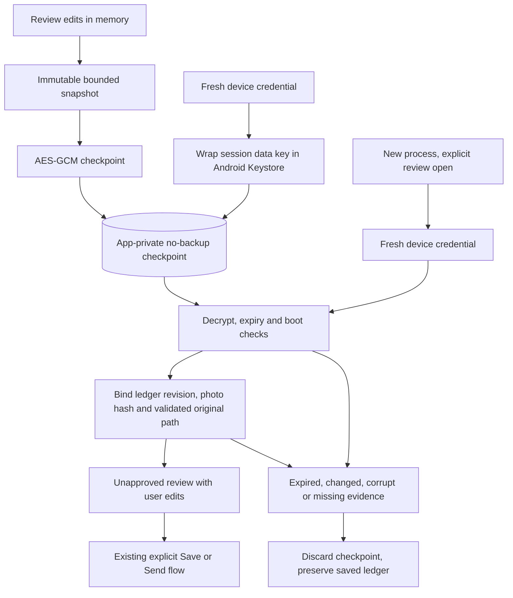

# Process-death review recovery (#358)

Status: proposed, inactive. Design review precedes implementation and activation. This document does not claim that unsaved edits currently survive process death.

## Baseline and decision

At main `c91fa30e738ec5206dd7c1d21f920d63cfd7be9f`, `AppShell` opens the existing Room ledger directly. That ledger is not application-layer encrypted. `ReviewRotationState` holds one screen and shell in process memory for at most 60 seconds, with independent timestamps. It restores rotation only. #536 tests real Activity recreation and revision continuity; #537 retains user plate edits and prevents automatic OCR from undoing a deliberate clear. Neither proves process death.

Add a separate encrypted, app-private, short-lived checkpoint of the active unsaved review. Do not activate the unfinished encrypted-ledger migration as a prerequisite, copy plaintext into Room, or store personal fields in saved-instance state. Restore only after a new device-credential authentication and fresh validation of the matching saved report. Recovery is never approval to send.

Chosen first-slice limits:

- One checkpoint total. No history, queue, account sync, export or backup.
- Absolute 15-minute lifetime from recovery-session creation, not from the last keystroke. Autosave and restore cannot extend it. A new explicit review opening after expiry can start a new session after authentication.
- Same boot only. Bind authenticated metadata to Android boot count plus monotonic creation/deadline values. Require an available, matching boot count and `created <= elapsedRealtime < deadline`; reject clock reversal or unavailable boot identity. Wall time is diagnostic only and cannot extend retention.
- Devices without a secure lock retain today's memory-only behavior. Never create an authentication-free fallback key.
- Proposed interaction: fresh credential check on starting durable recovery and on recovery after process death. Cancel means ordinary memory-only review or return to saved draft, never data exposure or Send. No repeated auth popup per keystroke.
- New user-facing explanation/error text and accessibility announcements must be reviewed before activation. This design PR adds no app copy or controls.

## Data contract and exclusion boundary

Use a versioned `ReviewRecoverySnapshot`, not serialized Compose state or `Held` via reflection. Bound ciphertext to 256 KiB and decoded strings/lists to explicit per-field limits. Reject duplicate/unknown keys, non-finite coordinates, invalid enums, malformed UTF-8, unknown versions and trailing data. Define exact limits in the codec slice and test their boundaries before any caller is added. Do not truncate user text silently.

Persist only the state needed to reconstruct the active review:

- Stable report ID, original SHA-256, expected ledger revision and digest of the saved initial draft. Initial content is re-read from the ledger and must match, not trusted from disk metadata.
- Edited `ReviewDraft`, raw plate input (including incomplete input), plate edit provenance, raw coordinate text, raw manual street/house/cross-street, OCR prefill baseline, edit-panel state, user-text provenance and template ownership state.
- Saved manual-input baseline and any address warning baseline needed to distinguish automatic prefill from user edits. An omitted field must have an explicit safe default, not silently clear a warning.
- Confirmed manual address only as a typed candidate for validation. Do not revive in-flight location/geocoder/registry/OCR results or callbacks. Old suggestions may be dropped and explicitly requested again.

Do not persist credentials, settings/profile values, images, image bytes, absolute file paths, device authentication results, pending authentication callbacks, approval tokens, reviewedDigest authority, Send-ready grants, submission receipts, submission state, network handles, busy flags, pending jobs, or automatic retry intent. Keep the existing saved ledger and original file as their own sources of truth. A checkpoint does not delete or create originals or ledger rows.

An open discard dialog may be restored as UI only. It cannot encode a Save/Discard decision. Restoring a draft never marks it submitted, approved or currently authenticated. Existing validation and Send/device-auth paths run anew. If the durable submission state indicates started, partial, uncertain or submitted work for that report, do not apply a recovery checkpoint over that state: route through the existing reconciliation/receipt path with no automatic write.

## Encryption and key lifetime

Use platform AES-256-GCM with fresh provider-generated 12-byte nonces and 128-bit tags. Separate domains for wrapped key and snapshot, with canonical length-prefixed AAD binding version, session ID, report ID, initial-draft digest, expected revision, original hash, boot identity and fixed creation/deadline. Authenticate all routing and retention metadata. Reject before allocating large payloads and authenticate before parsing sensitive content.

Use a dedicated Android Keystore alias, not settings or inactive ledger keys. The Keystore wrapping key requires recent device credentials, using the existing supported API-level branching. At session start after authentication, generate a random 32-byte session data key and wrap it. Keep the unwrapped key only in process memory for that session so edits can be checkpointed without another authentication prompt. On process restart, a new explicit authentication is required to unwrap it; a previous auth success boolean never suffices. The restore callback must bind a fresh generation and report ID so a late callback cannot reopen another report.

Zero mutable key/plaintext byte arrays on session end, background locking, expiry, replacement or failure. JVM strings/copies cannot be reliably erased: do not claim forensic memory erasure. If locking clears the session key, resume requires authentication before further writes or recovery. Do not weaken key policy to rescue data. Permanent key invalidation discards the unusable checkpoint; transient Keystore/auth errors retain ciphertext until its original expiry and offer only an explicit retry, never delete valid settings/ledger keys. No secrets in logs, exception text, tests or filenames.

`setUnlockedDeviceRequired` is not a substitute for credential authentication and has documented old-OS limits. Do not make it the sole security boundary. Minimum API remains the app's existing target, not a new platform promise.

## Storage, ordering and crash behavior

Use a single fixed path under `context.noBackupFilesDir`, a strict size-limited envelope and serialized I/O. A fixed filename avoids report IDs or addresses in filenames. `AtomicFile` is a write primitive, not a lock or a promise of secure deletion. Own one mutex/single writer and handle its backup artifacts during cleanup. Never write plaintext temporaries. Filesystem unlink is logical deletion, not guaranteed physical erasure; wrapped-key deletion and retention bounds are the recovery boundary.

Capture immutable state on Main, encrypt/write on I/O. Use a monotonically increasing generation; coalesce keystrokes with a proposed 300 ms debounce and a bounded background flush. Never let an older slow write replace a newer snapshot. If process death occurs before a successful commit, only the last committed snapshot is recoverable. Do not claim zero lost keystrokes. A failed write leaves the prior valid checkpoint within the same original deadline and does not block editing or imply a successful backup.

Every terminal event (successful explicit Save, explicit Discard, leaving the report, report replacement, submission start, expiry) invalidates the session generation before cleanup. Cancel queued work, prevent new commits under the invalidated generation and delete checkpoint artifacts. A Save failure retains unsaved recovery state. Starting Send must not be blocked by a failed checkpoint deletion alone, but recovery must independently consult submission state and reject stale checkpoints. Define ordering with the existing durable submission checkpoint before activation; no new municipal operation or retry is introduced here.

On startup, sweep expired/corrupt/orphaned checkpoint files without opening a report automatically. On explicit open, authenticate, decrypt and check the saved baseline/revision, then use the same canonical-path and hash validation as `openRecord`. Missing originals, changed bytes, changed revision, report mismatch or invalid state discard recovery only and preserve the saved report. No arbitrary path from the envelope is ever opened. Recover through ordinary ReviewScreen with no side effects; never resume a coroutine from the old process.

Expiry is enforced on every read/write and at app entry; a process that is not running cannot erase a file at an exact deadline. State this honestly. An expired ciphertext may remain physically present until the next app run but must never be recoverable through app code. No alarm, service or background polling is added merely to erase it.

## Implementation slices and gates

Each slice gets its own issue-linked PR, fresh exact-head independent review and full green CI. No auto-merge, required-check changes, paid runners, real evidence or municipal requests.

1. Pure snapshot/codec/retention policy and mutation tests. Inactive, no filesystem/Keystore or production caller.
2. Inactive encrypted envelope/store and Android Keystore session wrapper. Test authenticated metadata, write ordering, atomic failure, auth cancel/expiry/invalidation, backup cleanup. Do not reuse inactive ledger migration code as if it were active custody.
3. AppShell/ReviewScreen recovery integration behind an internal disabled-by-default activation boundary, with no user data written while disabled. Review proposed copy first. Restore raw fields and provenance together; don't add competing baselines.
4. Real kill/restart proof plus activation PR. Do not close #358 on codec tests or Activity recreation alone. Update architecture and Hebrew guide only when behavior is activated and proven.

### Required tests

Pure tests: round-trip every raw/edit field, OCR-prefill clean baseline, manual raw input dirty state, expired-at-boundary, boot mismatch/unavailable boot, backwards monotonic time, non-extending writes/restores, stale revision/digest/hash, tampering with every authenticated metadata field, ciphertext/nonce/tag corruption, wrong key, unknown version, malformed/oversized payload, redacted diagnostics, no auth/submission fields accepted.

Storage/concurrency tests: process dies during first write and replacement, older snapshot completes last, Save/Discard/Send races queued writes, AtomicFile backup recovery, disk-full/write exception, key loss/permanent invalidation, transient Keystore failure, late auth callback after navigation, locked device, no secure lock, failed deletion and orphan cleanup. A failed auth never returns decoded fields.

Device proof must run from a separate controller that survives target-process death. An instrumentation test inside the app process cannot kill itself and then certify restart. Use a debug-only non-exported synthetic fixture host plus an external shell/controller on free CI emulators, with a strict exit/results parser. Launch, type distinct plate/address/manual fields, await an explicit checkpoint commit signal, background, kill only the target process, relaunch, authenticate, verify recovered raw values and original/revision binding. Assert PID changes. No `ActivityScenario.recreate()` or `StateRestorationTester` substitution for this gate. Test force-stop separately and document any platform difference, rather than claiming it is identical to low-memory death.

Exercise API 29/30/36 as the current matrix permits. For credential interaction use the existing visible-PIN readiness discipline, synthetic emulator lock only. Include auth cancel, expired session, boot change, missing photo, stale saved revision, no-lock device, plaintext scan of checkpoint directory, and explicit Send still requiring a new device-auth path with mock transport. Assert zero municipal traffic and no restored approval. Capture/inspect synthetic screenshots before Send. Mutation checks must remove the real write hook and retention/auth checks and make the corresponding test fail.

## Evidence and limits

Source-of-truth code at this baseline: `ReviewRotationState.kt`, `ReviewScreen.kt`, `AppShell.kt`, `SecureSettings.kt`, `ReportDatabase.kt`; `EncryptedRecordCodec.kt` and ledger journal components are explicitly inactive. This design does not encrypt existing ledger contents or photos, establish a remote backup, certify physical-device behavior, authorize live filing or change existing no-retry rules.

Official Android references checked for this design:

- [Cryptography](https://developer.android.com/privacy-and-security/cryptography): AES/GCM recommendations, Keystore provider guidance.
- [Keystore key parameters](https://developer.android.com/reference/android/security/keystore/KeyGenParameterSpec.Builder): authentication requirements, invalidation and unlocked-device limitations.
- [SystemClock](https://developer.android.com/reference/android/os/SystemClock): monotonic elapsed time, including sleep and reset on reboot.
- [Context](https://developer.android.com/reference/android/content/Context): app-private no-backup directory.
- [Settings.Global.BOOT_COUNT](https://developer.android.com/reference/android/provider/Settings.Global#BOOT_COUNT): boot counter available since API 24; fail closed when it cannot be read.
- [AtomicFile](https://developer.android.com/reference/android/util/AtomicFile): atomic write/recovery primitive, not concurrency control.

Parameter choices (15 minutes, one slot, debounce and size budget) are proposed product/security limits, not claims from Android docs. Independent design review may tighten them before implementation. Any user-visible behavior/copy change remains subject to the established product-copy review process.
