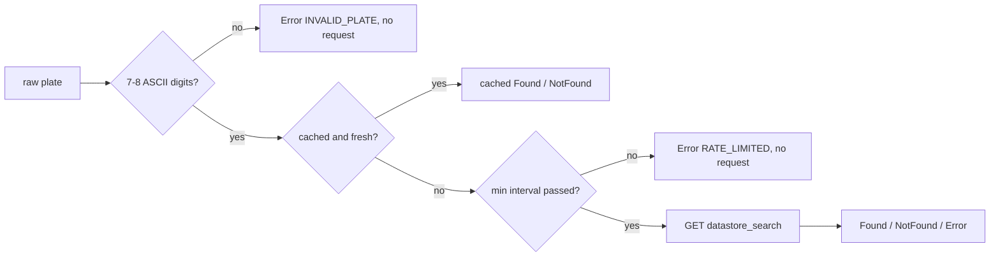

# Vehicle registry lookup (data.gov.il)

Issue #102. `app/src/main/java/io/github/reihlinstinct/reporter/registry/VehicleRegistryClient.kt` is a small read-only client that checks whether a plate exists in the official vehicle registry and reads its licence date. It is not wired into the UI yet.

## Dataset

| | |
| --- | --- |
| Portal | data.gov.il (CKAN) |
| Dataset | "מאגר מספרי רישוי של כלי רכב" (vehicle registration numbers), package `7a338622-63bb-4cfd-b3f7-0d2e8cf71033` |
| Resource | `053cea08-09bc-40ec-8f7a-156f0677aff3` (`VehicleRegistryConfig.KNOWN_VEHICLE_RESOURCE_ID`), about 4.2 million rows (estimated count, 2026-11-08) |
| Endpoint | `GET https://data.gov.il/api/3/action/datastore_search` |
| Update | daily, per the resource metadata |
| Key | none needed for public reads |

The resource id is runtime configuration: `VehicleRegistryConfig(resourceId = ...)` has no default, and the known value above is a documented constant the caller passes in. If the portal publishes the data under a new resource, only the config changes.

Verified on 2026-11-08 with one public metadata read (`datastore_search` with `limit=1`, and `resource_show`): the resource id, the package id, the daily update, the field names and types below, and that the call works without a key. The record that came back was not kept anywhere. Not verified live: the `filters` and `fields` parameters with a real plate (CKAN's documented `datastore_search` parameters; tests cover them against recorded synthetic responses only), and how data.gov.il treats an API key header. The `Authorization` header name is CKAN's convention, which is a guess for this portal.

The resource name covers registered vehicles in general; whether every vehicle kind (for example motorcycles or deregistered vehicles) is in this one resource was not checked. Other data.gov.il vehicle resources are not looked up.

## Fields used

The client asks for these fields only (`fields=` parameter) and ignores anything else.

| Field | Type in the datastore | Meaning | `VehicleRecord` |
| --- | --- | --- | --- |
| `mispar_rechev` | numeric | plate number | `plate` (also checked against the request) |
| `tokef_dt` | text, `YYYY-MM-DD` | licence valid until | `licenceValidUntil`, `licenceStatus(today)` |
| `mivchan_acharon_dt` | text, `YYYY-MM-DD` | last annual test | `lastTestDate` |
| `tozeret_nm` | text | manufacturer | `manufacturer` |
| `kinuy_mishari` | text | commercial model name | `commercialName` |
| `tzeva_rechev` | text | colour | `colour` |
| `shnat_yitzur` | numeric | year of manufacture | `yearOfManufacture` |

Ownership type, VIN and the other columns are not requested.

## Behaviour

- Plate input: spaces, hyphens and dots are removed; the rest must be 7 or 8 ASCII digits with no leading zero (the field is numeric). Anything else returns `Error(INVALID_PLATE)` without a request.
- Request: one GET to `/api/3/action/datastore_search` with `resource_id`, `filters={"mispar_rechev":<number>}`, `fields` and `limit=1`. No other endpoints, no writes.
- Results: `Found(record)`, `NotFound` (empty `records`), or `Error(kind)`: `HTTP` (non-2xx, with the status; redirects are not followed), `MALFORMED_RESPONSE` (not CKAN JSON, over 64 KiB, or a record for a different plate), `API_FAILURE` (`success` is not `true`), `NETWORK` (any I/O error or timeout).
- Network: connect and read timeouts 10 s, call timeout 20 s, `retryOnConnectionFailure(false)`, as in `LoginDiagnostic.safeClient()`. Failures are never retried.
- Rate limit: a minimum interval between network requests (default 1 s). A request inside the interval is denied with `Error(RATE_LIMITED)`, not queued. Cache hits do not count.
- Cache: in memory, LRU (default 128 entries) with a TTL (default 6 hours). `Found` and `NotFound` are cached; errors are not. Both the TTL and the limiter use an injectable monotonic clock.
- API key: `VehicleRegistryConfig.apiKey` is nullable and `null` by default. When set it is sent as the `Authorization` header, and only then. It comes from the encrypted settings (separate work), never from the repository or the build.
- HTTPS with a key: when `apiKey` is set, `VehicleRegistryConfig` rejects a `baseUrl` that is not https (or does not parse) with an `IllegalArgumentException` whose message names neither the key nor the URL; with no key, any base URL is accepted as before. (#114)
- Privacy: no logging. `PlateNumber`, `VehicleRecord` and `VehicleRegistryConfig` redact the plate and the key in `toString()`, and errors carry only a kind and an HTTP status, never a server text or an exception message.
- `lookup()` blocks; callers run it off the main thread.

## Tests

`app/src/test/java/io/github/reihlinstinct/reporter/registry/VehicleRegistryClientTest.kt` runs against MockWebServer with recorded synthetic responses in `app/src/test/resources/registry/` (fake plates such as 1234567). No test touches the network.
