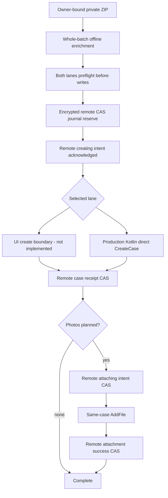

# Hybrid runtime integration: inactive delivery slice

Depends on the optional author-input contract. Not an active filing workflow.

## Implemented in this slice

- `live_batch_persistence.py`: existing journal transactions backed by authenticated
  AES256GCM snapshots to fixed `parking-reports/journal/live-batch.sqlite.aesgcm`
  on main. GitHub Contents SHA compare-and-swap makes stale writers fail. Every
  reservation/intent/result transaction must be acknowledged remotely before
  returning. Save failure poisons the local instance. Missing/corrupt/oversized
  remote journal blocks; no implicit bootstrap, reset or retry. SQLite FULL sync
  and consistent backup are used. Current768KiBplain cap is conservative and
  requires deliberate storage migration before growing beyond it.
- `live_batch_hybrid.py`: injected UI/direct ports, one or two UI report IDs,
  whole-batch preflight, whole-batch reserve, sequential per-write durable state.
  No adapter fallback/resume/release. Zero-photo CreateCase completes. Mock tests
  cover preflight failure, create uncertainty and attachment failure across lanes.
- `BatchMunicipalBridge.kt` in test sources: private stdio IPC to production
  MunicipalClient/MunicipalPayloads/StreetDirectory. Compile once via
  `:app:writeBatchBridgeClasspath`, not a Gradle invocation per report. Read-only
  login, offline report preflight, CreateCase and AddFile use production code.
  It prints only private JSON IPC, not stdout intended for public CI. No live
  caller is enabled. Adapter death/error stops the session; no automatic retry. Private subprocess
  I/O has a single absolute write/read deadline; partial output cannot hang a
  line reader and any error kills/poisons the process. Six real subprocess
  tests cover partial replies, no stdin consumption, process death and malformed
  responses. Photo preflight verifies hashes, format and full ImageIO decode
  before login, with8192edge/24millionpixel/10MiBlimits before allocation.
  These JVM checks do not establish UI-adapter parity.
- `live-batch-hybrid.yml`: protected main-only first-attempt **preparation-only**
  dispatch with immutable private ref/path/outerdigest. It builds bridge before
  private input, stages/validates the ZIP, encrypts the effective manifest and
  uploads only encrypted preparation evidence. It receives no city credentials
  and cannot call the controller/bridge or make a municipal write. Missing
  private read token/topic policy is a blocker, not silently provisioned. The read
  variable maps only to protected `BATCH_PRIVATE_CONTENTS_TOKEN`, a narrow
  fine-grained credential for private parking-reports Contents read/write and
  Metadata read-only. The credential was provisioned separately under owner
  authority on November17 and expires December17,2026; it is not a repository
  secret and does not grant municipal access.

## Not delivered and activation blockers

1. UI create/attach boundary adapter. The existing all-in-one single-report UI
   workflow cannot safely be called as a black box: it would have separate app
   state and could write before the shared journal acknowledged intent.
2. Persistent journal initial provisioning, verified old-case import and journal
   key approval remain blocked. The narrow private credential is provisioned
   separately in the protected environment; no broad account PAT is copied
   into Actions. No journal was created by this slice.
   A fresh journal must include existing accepted/uncertain identities, not erase
   duplicate history. Old14dayartifacts alone are insufficient.
3. Live credential injection, UI-lane bounded decoding and outgoing attachment
   policy parity, verified topic policy freshness and exact effective-manifest
   approval binding. Input validation is not permission.
4. Read-only production login probe in the final network environment, tunnel
   setup/cleanup and verified pre-write fallback policy. Prior direct logins have
   succeeded, later tunnel fallback was needed; current future egress is unknown.
   No new live probe or municipal write was run for this slice.
5. Shared concurrency across ALL old/new live entry points. New preparation uses
   the current UI group, but the legacy engine has its own group. Do not activate
   a writer until both converge and the CAS journal owns both lanes.
6. Cache550consumer integration and cold fallback. Producer is merged, first
   scheduled output not yet verified/benchmarked. No speed savings claimed.
7. Full UI/direct mock HTTP integration, authenticated backup rollback
   protection beyond CAS, malformed/oversized image decode
   matrix, leak tests on actual encrypted evidence inventory and supervised
   owner-approved live proof. Current controller tests use injected mocks;
   persistence tests cover save failure and reopening. A real hybrid controller
   child-process exit at each of four UI/direct create/attach boundaries proves
   encrypted file-backed remote intent survives and forbids replay on reopening.
   This is not a full emulator/UI-adapter process-death proof.

No new workflow pretends these gates are satisfied. Existing single-report route
remains unchanged. The author guide remains honest about the missing submit step.

## Next-batch acceptance criterion: zero PRs in the filing loop

The next operational batch must need **no source PR and no data PR**. One-time
implementation changes still follow independent exact-head review and green CI.
Per batch: prepare approved private ZIP, commit it directly to the existing
private data repository, bind its full immutable commit/path/outerSHA256, then
protected workflow_dispatch. Explicit approval of exact text/location/topic/photo
bytes remains required and is bound by the generated outerdigest. Input data is
not source code. No private CI run or paid runner is needed. A preparation-only
workflow does not satisfy this criterion; no live route is claimed ready until
both lanes, durable oldidentityjournal and credential/approval boundaries work.

### Inactive workflow gate

The preparation job is hard-disabled in source (`if: false`). Dispatch cannot
expose its environment secrets while this route is inactive. Activation requires
a separate reviewed change and verification of required environment reviewers;
no environment protection/settings were changed here. Preparation also requires
independent approved outer package, decrypted ZIP and address-directory SHA256
values. The fetch layer already checked outer approval before this change; the
entry script now repeats it explicitly and no longer derives inner/directory pins
from the bytes being checked. A rerun counter is not access control.
