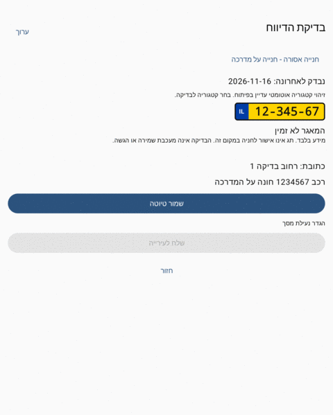
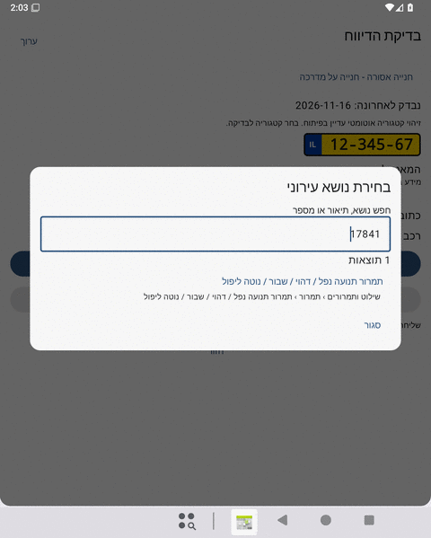
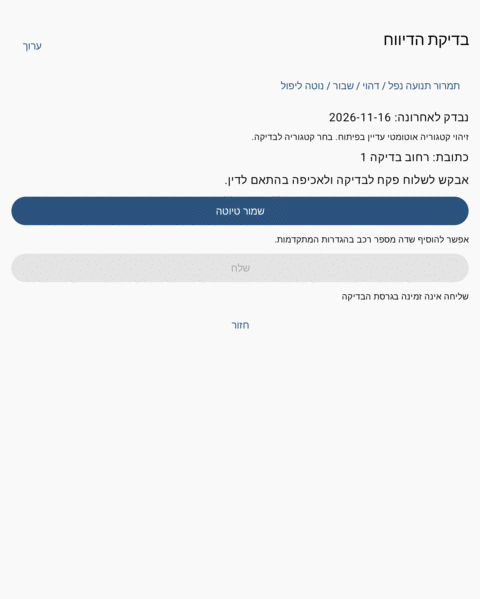

# מדריך למשתמש - דיווח חניה (אנדרואיד)

> **גרסת פיתוח, לא אישור למוכנות לייצור.** קיים מסלול שליחה אמיתי לעירייה בכפוף להגדרות ולתנאי הבטיחות. בצילומי המסך כאן השליחה חסומה והנתונים סינתטיים; אין להסיק מכך שהשליחה חסומה בכל התקנה. הלוחית והכתובת בדוגמאות מומצאות; התאריך הוא תאריך בדיקת האמולטור.

המדריך מתאר צילום, בדיקה והגדרות בגרסת הפיתוח. צילומי המסך נוצרו באמולטור; הם אינם הוכחה לתקינות במכשיר פיזי או לשליחה אמיתית.

## 1. מסך הבית

- **צלם תמונה** - פותח את המצלמה. התמונה המקורית נשמרת כמו שהיא, עם טביעת אצבע (SHA-256).
- **העלה תמונה** - בוחר תמונה קיימת מהמכשיר.
- **טיוטות** - דיווחים שמורים שעוד לא נשלחו.
- שורת הניווט למטה: **בית**, **הדיווחים שלי**, **הגדרות**.

## 2. בדיקת הדיווח

אחרי צילום או העלאה נפתח מסך הבדיקה.

- האפליקציה מציעה לוחית מקומית על המכשיר (OCR). זו הצעה בלבד: בודקים ומתקנים ידנית בכפתור **ערוך**.
- הצעת כתובת היא אופציונלית ובאישורכם, והיא אינה הוכחה. אפשר לתקן אותה ידנית, גם כצומת רחובות (האפליקציה מציעה את הכתובת המספרית הקרובה).
- בלי קטגוריה אי אפשר לאשר דיווח. תג נכה ופרטי הרכב מוצגים כמידע בלבד, לא כאישור או כשלילה.
- **שמור טיוטה** שומר בלי לשלוח. כל עריכה מבטלת אישור קודם.

## 3. בחירת נושא עירוני (קטגוריה)

פותחים את הבחירה ומחפשים לפי שם, תיאור או מספר נושא. אחרי הבחירה התיאור מתעדכן בהתאם.

## 4. הגדרות

- **זיהוי לוחית מהצילום**: בחירה בין Google ML Kit לבין Tesseract (שני המסלולים מבצעים זיהוי על המכשיר). הבחירה משפיעה רק על הצעת הלוחית; התוצאה תמיד דורשת אישור שלכם. ML Kit שולח ל-Google נתוני שימוש וביצועים (לא את התמונות או הלוחיות) ועשוי לפנות לשרתי Google לעדכונים.
- **פרטי מדווח** (שם, משפחה, מספר זהות, טלפון, אימייל): מוזנים ידנית ונשמרים מוצפנים במכשיר בלבד. עד שכל השדות תקינים אי אפשר לשמור.

## 5. הדיווחים שלי

בלשונית **הדיווחים שלי** מופיעים דיווחים שנשלחו, לפי מספר פנייה. לחיצה על דיווח פותחת את פרטיו (מספר פנייה, תאריך, קטגוריה וכתובת); **חזרה** מחזיר לרשימה.

## מה עוד אין

- אין לראות בבדיקות האמולטור אישור לשלוח דיווח אמיתי. אין לבצע שליחה בלי בדיקת התוכן, ההרשאות ותנאי השליחה.
- התקנה מחנות: בונים APK בדיקה בעצמכם, ראו [מה האפליקציה עושה היום ואיך בונים](he-parking-reporter-preview).
- בכל שינוי נראה לעין יש לבדוק אם המדריך דורש עדכון (ראו רשימת הבדיקה בתבנית ה-Pull Request).

## פרטיות

- לא מעלים לריפו או לוויקי תמונות, לוחיות או פרטים אמיתיים.
- זיהוי הלוחית מקומי. אם משלימים שליחה אמיתית, פרטי הדיווח והתמונה שנבחרה נשלחים לשירות העירוני; אישור בדיקה מקומי ושמירת טיוטה אינם שליחה.
