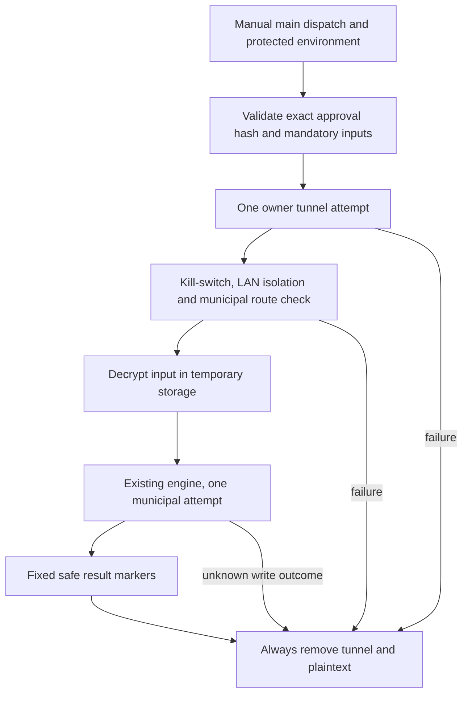

# M0 engine-level live trial (owner-approved 2026-11-09)

One owner-approved trial of the app's municipal submission engine from
GitHub Actions. Design:

- **Engine-level**: `EngineLiveTrialTest` drives the app's real classes
  (`SubmissionCoordinator`, `SubmissionStateMachine`, `OkHttpMunicipalClient`,
  `StreetDirectory`) on the JVM. No emulator, no screens.
- **Two phases** (workflow_dispatch input):
  1. `login-only` - diagnostic Login call only. No case writes.
  2. `submit` - one real case, gated by `approved_sha256`: the approved
     text must hash to the dispatch input the owner approved in chat.
     Same binding as the helper pipeline's `--approved-sha256`.
- **Transport**: login-only retains its diagnostic direct-first behavior.
  Real submit is VPN-first: validate mandatory inputs, bring up the owner's
  L2TP/IPsec tunnel once, verify every municipal IPv4 route uses PPP, then
  invoke the municipal engine once. A missing secret or tunnel/route failure
  stops before LOGIN. No direct-submit fallback or case retry is allowed.
  HTTPS cannot bypass PPP and IPv6 HTTPS is rejected. PPP destinations in
  private/local/shared address ranges are blocked, so the tunnel is an
  internet exit rather than access to home-network devices.
- **Guards**: manual dispatch on the canonical repository's main branch only,
  protected environment, exact approved text hash, existing engine checkpoint,
  duplicate-photo/unknown-outcome safeguards, concurrency, and always-cleanup.
  The private filing reservation must be reconciled before each dispatch;
  an uncertain prior municipal write is never grounds for another attempt.
  Public CI still requires trusted, reviewed code: secrets masking does not
  protect against malicious workflow/dependency code. Do not add PR/fork secret
  jobs. Keep all report data out of source, output and artifacts.
- **Privacy**: report specifics (plate, address, coordinates, capture time,
  street lookup) live only in Actions secrets and are passed as env; the
  photo lives here only as `trial-photo.jpg.enc` (AES-256-CBC/PBKDF2, key
  in the `TRIAL_DATA_KEY` secret, decrypted to /tmp inside the runner and
  deleted in the always-cleanup step). Nothing report-specific is printed;
  outcomes print only a fixed `TRIAL_RESULT` line.
- The workflow refuses to run from any ref except `main`.
- `TRIAL_SUBJECT` must name a supported app category (for example
  `sidewalk_parking` or `bollard_request`). There is no default: a missing or
  unknown category blocks the run. `TRIAL_PLATE` may be absent only for a
  plate-free category; normal draft validation still applies.
- Adding a category does not authorize a filing or bypass the environment
  approval gate. Every real submit still needs its exact approved text hash.

After the trial concludes, this directory and the workflow are removed and
the `TRIAL_*` secrets deleted.

Note: the encrypted photo blob stays in this repo's git history even after
trial/ is removed; the TRIAL_DATA_KEY's secrecy is the only protection, so
the key must never leave the secrets store.

## VPN-first submit sequence

No edge returns from a municipal result to submission. An unknown outcome
requires private reconciliation, never automatic retry. The tunnel's secret
values and raw negotiation output must not be printed or uploaded.
